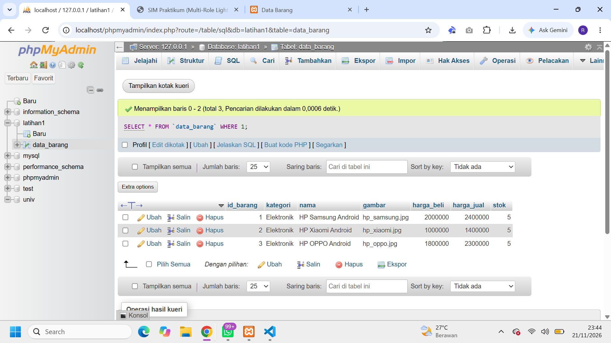

# Lab8Web
# Praktikum 8: PHP dan Database MySQL

**Mata Kuliah: Pemrograman Web**
**Nama:Rifki Ade Tia**
**NIM: 312510334**
**Kelas: I253C**

---

## Deskripsi

Aplikasi CRUD sederhana untuk mengelola data barang menggunakan PHP dan database MySQL. Aplikasi dapat menampilkan, menambah, mengubah, dan menghapus data barang beserta gambarnya.

## Tujuan

1. Memahami konsep dasar database.
2. Memahami konsep dasar CRUD menggunakan PHP.
3. Membuat program CRUD sederhana menggunakan PHP.

## Teknologi

- PHP
- MySQL / MariaDB
- XAMPP (Apache dan MySQL)
- phpMyAdmin
- HTML dan CSS
- Visual Studio Code

## Struktur Folder

```
Lab8Web/
├── README.md
├── koneksi.php
├── index.php
├── tambah.php
├── ubah.php
├── hapus.php
├── style.css
├── gambar/
└── screenshots/
```

| File | Fungsi |
|------|--------|
| `koneksi.php` | Koneksi ke database |
| `index.php` | Menampilkan data (Read) |
| `tambah.php` | Menambah data (Create) |
| `ubah.php` | Mengubah data (Update) |
| `hapus.php` | Menghapus data (Delete) |
| `style.css` | Tampilan halaman |

## Database

- **Database:** `latihan1`
- **Tabel:** `data_barang`

| Field | Tipe Data | Keterangan |
|-------|-----------|------------|
| id_barang | INT(10) | Primary Key, Auto Increment |
| kategori | VARCHAR(30) | |
| nama | VARCHAR(50) | |
| gambar | VARCHAR(100) | |
| harga_beli | DECIMAL(10,0) | |
| harga_jual | DECIMAL(10,0) | |
| stok | INT(4) | |

## Tampilan Program

### Data di phpMyAdmin


### Halaman Utama (Read)


### Tambah Barang (Create)


### Ubah Barang (Update)


### Hapus Barang (Delete)


## Kesimpulan

Dengan praktikum ini, aplikasi CRUD sederhana berhasil dibuat menggunakan PHP dan MySQL untuk menampilkan, menambah, mengubah, dan menghapus data barang.
